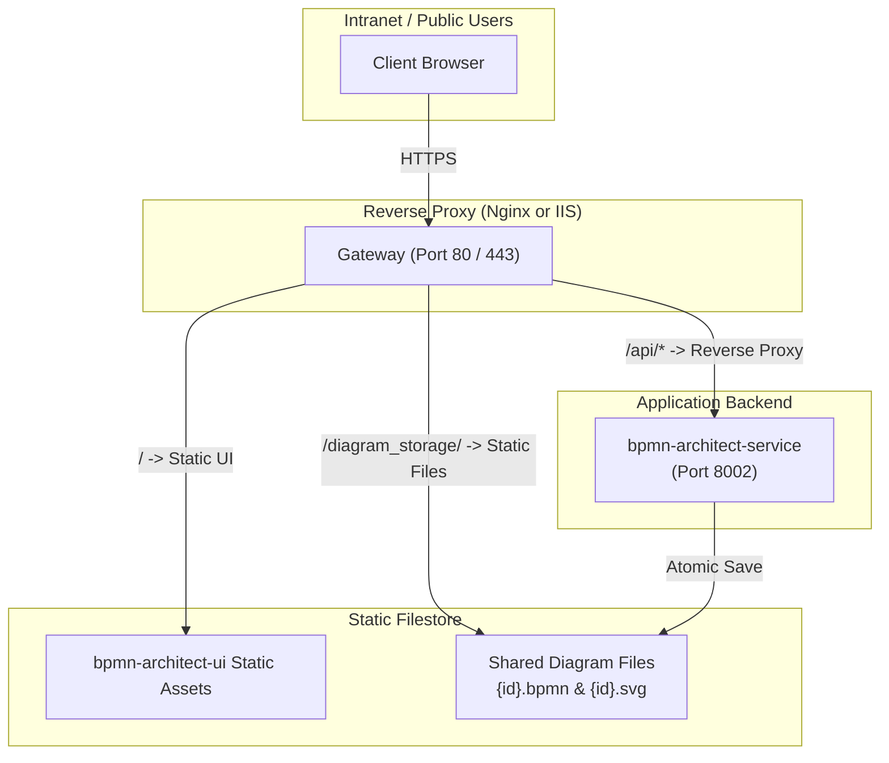

# Production Deployment Overview

This document describes recommended production deployment topologies for the BPMN Architect suite.

---

## Architecture Topology

---

## Deployment Options

1. **[Windows IIS & ARR Deployment](/deployment-iis)**:
   - Host `bpmn-architect-ui` as a static IIS site.
   - Run `bpmn-architect-service` via Windows Service or IIS FastCGI / HttpPlatformHandler.
   - Use Windows Integrated Authentication (Kerberos / NTLM) with `AUTH_METHOD=iis-header`.
2. **[Linux Nginx Deployment](/deployment-nginx)**:
   - Serve `bpmn-architect-ui` from `/var/www/bpmn-ui`.
   - Run `bpmn-architect-service` as a systemd service managed by Uvicorn or Gunicorn.
   - Map `/diagram_storage/` alias directly to the physical storage folder for static high availability.

