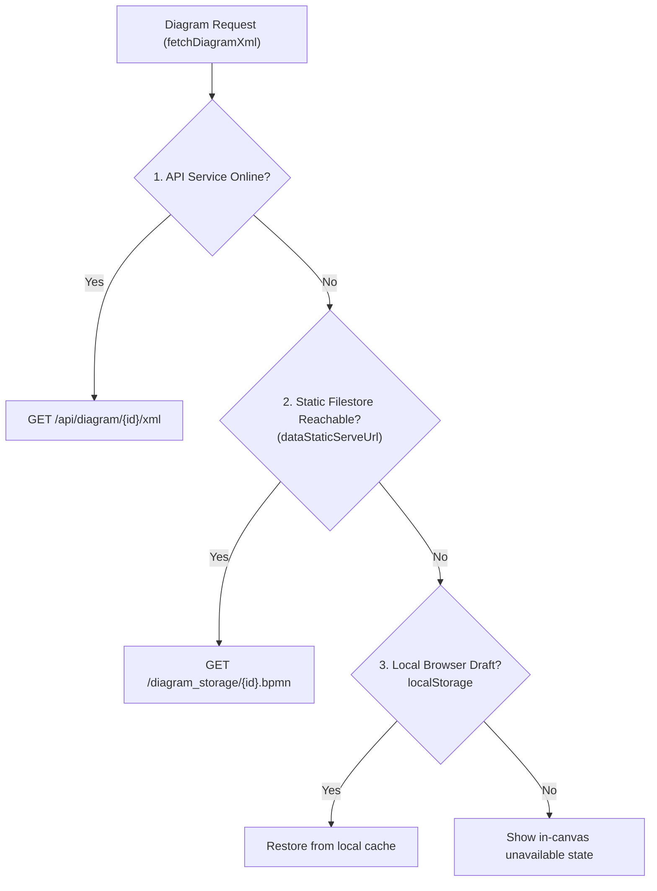

# Dual-Save & Offline Resilience

A major architectural pillar of BPMN Architect 2.0 is **high-availability offline resilience**: ensuring that process diagrams remain accessible for viewing and exporting even when the backend service is offline, down for maintenance, or undergoing network partitions.

---

## 1. Dual-Save Persistence

When a user clicks **Save** in the Modeler, `bpmn-architect-ui` sends a single unified payload containing:
- The updated **BPMN 2.0 XML** generated by `bpmn-js`.
- The pre-rendered **Vector SVG** extracted from the active canvas SVG element.
- Optional metadata updates (friendly name, project category, description).

```http
POST /api/diagram/A2nX5VOZAp1W/save
Content-Type: application/json
X-Master-Key: dev-master-key-12345
X-Username: a.taylor

{
  "bpmn_xml": "<?xml version=\"1.0\" encoding=\"UTF-8\"?>...",
  "svg_content": "<svg xmlns=\"http://www.w3.org/2000/svg\"...",
  "friendly_name": "Invoice Approval Flow",
  "project_name": "Finance"
}
```

### Atomic File Write Guarantees
Inside `service/components/storage.py`, files are saved atomically:
1. `A2nX5VOZAp1W.bpmn.tmp` is written to disk.
2. `os.replace("A2nX5VOZAp1W.bpmn.tmp", "A2nX5VOZAp1W.bpmn")` executes an atomic inode rename.
3. `A2nX5VOZAp1W.svg.tmp` is written and replaced atomically.
4. `A2nX5VOZAp1W.json.tmp` is written with timestamps and replaced atomically.

This ensures that partially written files or corrupted XML definitions never overwrite good files on disk.

---

## 2. High-Availability Static Fallback

The client web app (`api-client.js`) implements an automated 3-tier fallback hierarchy:



### Static Filestore Configuration
In `app/config.json`:
```json
"endpoints": {
  "serviceUrl": "http://127.0.0.1:8002",
  "dataStaticServeUrl": "/diagram_storage"
}
```
If Nginx or IIS maps `/diagram_storage` directly to the underlying physical folder, the client transparently reads `{id}.bpmn` and `{id}.json` directly over static HTTP if `serviceUrl` fails.

---

## 3. Client Recent Diagrams Manifest

To ensure the Process Library can list diagrams even when the microservice is offline, `bpmn-architect-ui` maintains a lightweight manifest in `localStorage` (`bpmn_recent_diagrams`).

### What is stored:
```json
[
  {
    "id": "A2nX5VOZAp1W",
    "friendly_name": "Invoice Approval Flow",
    "project_name": "Finance",
    "author": "a.taylor",
    "last_visited": 1730907080245,
    "has_svg": true
  }
]
```
> [!NOTE]
> The manifest only stores lightweight card metadata (names, IDs, timestamps). Large BPMN XML strings and SVG graphics are **not** stored in localStorage, preventing browser quota exhaustion.

---

## 4. Graceful, Non-Distracting Offline UI

When a diagram is loaded via static storage while the microservice is offline:
- **No Disruptive Popups**: The viewer never blocks the user with alarming alert dialogs or modal windows.
- **Top Ribbon**: Displays a subtle pill:  
  `<span class="badge bg-light text-muted border"><i class="bi bi-cloud-slash me-1"></i>API service offline</span>`
- **Lock Status**: Subtly indicates `API service offline (Read-Only)`.
- **Status Footer**: Notes `• Static storage mode (API service offline)`.
- **Edit Button**: Softens to an outline button with a tooltip explaining that editing requires the API microservice.

