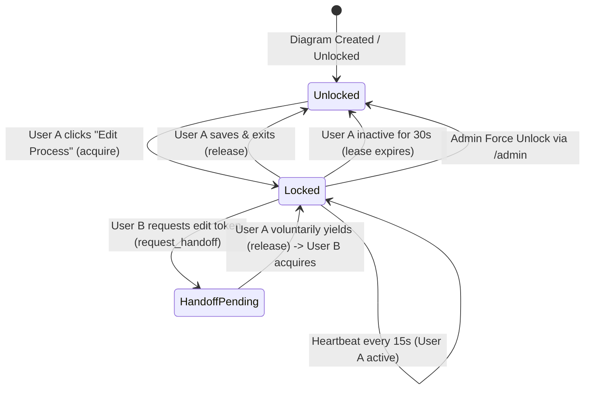

# Cooperative Soft-Locks & Presence

To prevent race conditions, accidental overwrites, and split-brain editing sessions without imposing rigid, disruptive timeouts, BPMN Architect employs an **in-memory cooperative soft-locking broker**.

---

## 1. Soft-Lock Principles

1. **Single-Active-Editor**: Only one user holds the active edit token for a diagram at any given moment.
2. **Read-Only Viewer Safe**: Users browsing diagrams in `/view/` do **not** acquire an edit token. Edit tokens are only requested when explicitly entering `/edit/`.
3. **Heartbeat Auto-Renewal**: While an editor is active in the canvas, their browser sends a heartbeat ping every 15 seconds (`LOCK_HEARTBEAT_SEC=15`).
4. **Cooperative Handoff Negotiation**: Rather than locking users out permanently if someone leaves a tab open, collaborators can request a handoff.
5. **Administrative Override**: Designated administrators can force release any stuck or hostage lock via `/admin`.

---

## 2. Lock Lifecycle & States



---

## 3. Lock API Actions (`POST /api/diagram/{id}/lock`)

The frontend communicates with `POST /api/diagram/{id}/lock` using standard JSON payloads:

### Action: `acquire`
Attempts to take the edit token. If currently held by another collaborator, returns status `locked` along with the username of the active editor.

```json
{ "action": "acquire" }
```

### Action: `heartbeat`
Renew the edit lease and check whether another collaborator has requested a handoff.
```json
{ "action": "heartbeat" }
```

Response includes `pending_handoff_to`:
```json
{
  "diagram_id": "A2nX5VOZAp1W",
  "is_locked": true,
  "locked_by": "a.taylor",
  "expires_in_sec": 30,
  "pending_handoff_to": "j.doe",
  "active_viewers": ["a.taylor", "j.doe"]
}
```

### Action: `release`
Voluntarily yield the edit token (triggered when clicking **Save & Close**, navigating away, or clicking **Yield Lock**).
```json
{ "action": "release" }
```

### Action: `request_handoff`
Sent by collaborator User B to request that User A yield the edit token. User A's editor surfaces a gentle toast notification asking them to save and release.
```json
{ "action": "request_handoff" }
```

---

## 4. Administrative Force Unlock

If a collaborator locks a process and leaves for the day, administrators can immediately clear the lock:
- Navigate to the **Administrative Console** at `/admin`.
- In the Diagram Inventory table, locate the locked diagram.
- Click **Unlock** (`POST /api/diagram/{id}/unlock`).
- The lock is forcibly cleared and available immediately to other team members.

